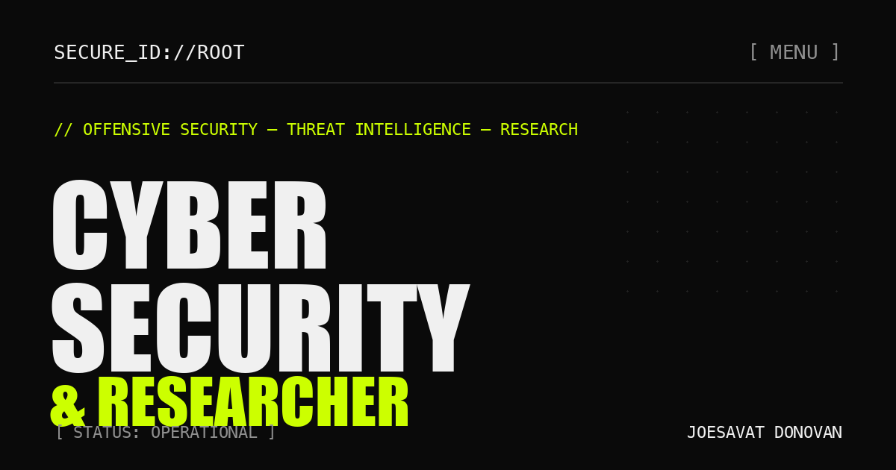
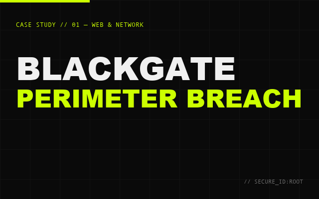
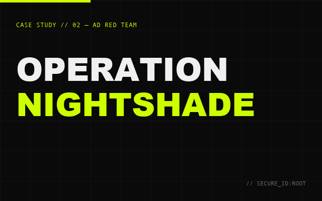
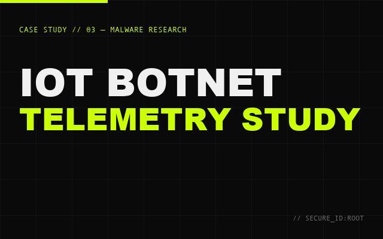
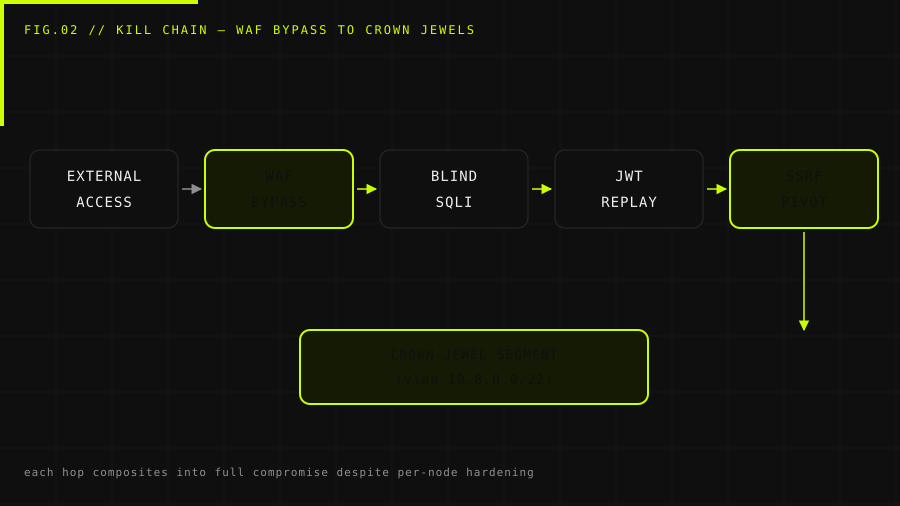
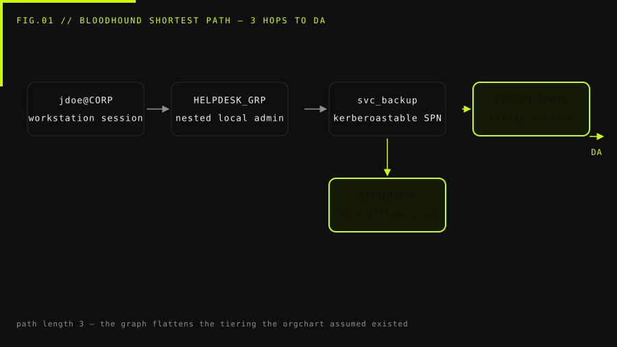

<div align="center">

# SECURE_ID://ROOT — Joesavat Donovan

**Offensive Security · Threat Intelligence · Malware Analysis · Vulnerability R&D**

[](https://cingmen.github.io/)
[](https://github.com/cingmen/cingmen.github.io/actions/workflows/site-checks.yml)
[](https://cingmen.github.io/feed.xml)
[](mailto:joesavat@gmail.com)

<br />

<a href="https://cingmen.github.io/">
  
</a>

</div>

---

## // Who I Am & How I Work

> *"Security is not a product — it is a mindset. You cannot defend what you have never tried to break."*

I am **Joesavat Donovan**, a cybersecurity practitioner operating with an **offense-first philosophy**: model the adversary, chain the small failures to demonstrate real business impact, and translate every exploit into durable, engineering-ready controls and detections.

Whether an organization needs to pressure-test an external perimeter before launch, uncover blind spots across an Active Directory forest, or turn raw malware telemetry into high-confidence YARA/Sigma detections, my engagements are scoped to deliver **reports that actually get fixed** — not automated scanner noise.

### Core Capabilities

| Discipline | Focus & Deliverables |
| :--- | :--- |
| **01 / Offensive Security** | External perimeter breaches, web/API exploitation (OWASP WSTG / PTES), and assumed-breach Active Directory red teaming chained to crown-jewel objectives. |
| **02 / Defensive & Purple Team** | Detection engineering mapped to MITRE ATT&CK, SIEM telemetry gap analysis, rate/behavior-based Sigma rules, and incident response playbooks. |
| **03 / Malware Analysis** | Static & dynamic reverse engineering (Ghidra, QEMU profiled sandboxes), custom unpackers, C2 protocol reconstruction, and zero-FP YARA rule production. |
| **04 / Vulnerability R&D** | Root-cause analysis, custom proof-of-concept (PoC) development, WAF/filter bypass research, and reproducible technical advisories. |

**Arsenal:** `Burp Suite Pro` · `Nmap` · `sqlmap` · `Metasploit` · `BloodHound` · `Rubeus` · `Impacket` · `Cobalt Strike` · `Ghidra` · `IDA Pro` · `Frida` · `QEMU` · `Wireshark` · `YARA` · `Splunk` · `Python` · `Go`  
**Certifications & Tracked Milestones:** `OSCP` · `eJPT` · `BTL1` · `CEH (in progress)`

---

## // Selected Case Studies

Client identifiers are redacted, while the methodologies, attack chains, and engineering remediations are documented in full on the live site.

<table>
  <tr>
    <td width="33%" valign="top">
      <a href="https://cingmen.github.io/projects/blackgate-perimeter-breach.html">
        
      </a>
      <h4><a href="https://cingmen.github.io/projects/blackgate-perimeter-breach.html">01. BlackGate Perimeter Breach</a></h4>
      <p><sub><b>Web & Network · Lead Pentester · Critical (9.1)</b></sub></p>
      <p>Bypassed a tuned WAF via unnormalized JSON Unicode escapes to exploit time-based blind SQLi, replayed an unrotated admin JWT, and pivoted through an invoice-renderer SSRF into the internal jump host.</p>
    </td>
    <td width="33%" valign="top">
      <a href="https://cingmen.github.io/projects/operation-nightshade-ad-red-team.html">
        
      </a>
      <h4><a href="https://cingmen.github.io/projects/operation-nightshade-ad-red-team.html">02. Operation Nightshade</a></h4>
      <p><sub><b>Internal Red Team · Active Directory · Forest DCSync</b></sub></p>
      <p>Assumed-breach exercise across ~1,200 endpoints. Mapped a 3-hop BloodHound path from a standard workstation to Domain Admin via Kerberoastable SPNs, then paired with the SOC to turn 7 telemetry blind spots into production Sigma rules.</p>
    </td>
    <td width="33%" valign="top">
      <a href="https://cingmen.github.io/projects/iot-botnet-telemetry-study.html">
        
      </a>
      <h4><a href="https://cingmen.github.io/projects/iot-botnet-telemetry-study.html">03. IoT Botnet Telemetry Study</a></h4>
      <p><sub><b>Malware Research · Reverse Engineering · 42 IOCs</b></sub></p>
      <p>Clustered 74 honeypot-captured MIPS/ARM binaries into 6 build waves, unpacked modified UPX headers, reversed runtime XOR key derivation and plaintext TLV C2 traffic, and shipped 9 YARA rules validated against 400k samples with 0 false positives.</p>
    </td>
  </tr>
</table>

### Sample Technical Figures from the Case Studies

<p align="center">
  
  
</p>

---

## // Field Notes, Write-ups & Live Lab Tools

### CTF & Research Write-ups
- **[HTB — Lame: Samba `usermap_script` to root](https://cingmen.github.io/writeups/htb-lame-samba-usermap-script.html)** (`CVE-2007-2447` / Linux PrivEsc) — Full walkthrough from Nmap reconnaissance to smuggling shell metacharacters inside an SMB username for immediate `uid=0(root)`.

### Public Security Tools (Live on Same Domain)
Two self-hosted, zero-telemetry tools I built and maintain under `cingmen.github.io`:
1. **[osint-harian](https://cingmen.github.io/osint-harian/)** — Daily deterministic watcher for public data (BMKG, OFAC, CISA, NVD, WHO, USGS, news RSS). Every run publishes a verifiable diff rather than another unread feed.
2. **[PhishQuest](https://cingmen.github.io/phisquest/)** — Indonesian anti-phishing training game featuring 40 realistic email, SMS, and WhatsApp scenarios in an arcade quiz + CLI mode for security awareness workshops.

---

## // About This Repository (Architecture & Engineering)

This repository is the entire source code for **[cingmen.github.io](https://cingmen.github.io/)**. Just like my security tooling, it is built for speed, auditability, and zero attack surface:

- **Zero Dependencies, Zero Trackers:** Handcrafted semantic HTML5, inline critical CSS, and vanilla ES6 JavaScript. No frameworks, no bundler, no cookies, no analytics, and **zero runtime third-party network requests** (every WOFF2 font subset, SVG diagram, and script is self-hosted).
- **Accessibility & Progressive Enhancement:** Full keyboard navigation, focus-trapped modal menu with `inert` background regions, high-contrast dark/lime palette (`#0a0a0a` / `#ccff00`), `prefers-reduced-motion` compliance, and custom `@media print` stylesheets so any page or case study prints cleanly as a brief/CV.
- **Technical SEO Ready:** Complete `Schema.org` JSON-LD structured data (`WebSite`, `Person`, `Article`, `BlogPosting`, `BreadcrumbList`), Open Graph / Twitter cards, `sitemap.xml`, and RSS 2.0 feed (`feed.xml`).

### Repository Structure

```text
cingmen.github.io/
├── index.html                                         # Main portfolio — hero, capabilities, arsenal, work, lab, contact
├── projects/
│   ├── blackgate-perimeter-breach.html                # Case Study 01 — External Web/Network Perimeter Breach
│   ├── operation-nightshade-ad-red-team.html          # Case Study 02 — Assumed-Breach Active Directory Red Team
│   └── iot-botnet-telemetry-study.html                # Case Study 03 — Mirai-Variant Malware & C2 Telemetry Study
├── writeups/
│   └── htb-lame-samba-usermap-script.html             # CTF Write-up — HackTheBox Lame (CVE-2007-2447)
├── 404.html                                           # Custom terminal-styled 404 error page
├── assets/
│   ├── diagrams/                                      # 7 custom-generated technical SVG diagrams
│   ├── fonts/                                         # Self-hosted WOFF2 subsets (Syne, Space Grotesk, Space Mono)
│   ├── icons/                                         # PWA & Apple touch icons
│   ├── js/                                            # Locally bundled Motion runtime for hero entrance
│   ├── thumbs/                                        # Case study hover preview cards
│   └── og-*.png                                       # 1200×630 Open Graph cards per page
├── tools/
│   ├── check_site.py                                  # Zero-dependency static verifier (links, anchors, alt, SEO, XML)
│   └── make_*.py                                      # Asset generators for SVG diagrams, OG cards & thumbnails
├── feed.xml                                           # RSS 2.0 feed for security write-ups
├── sitemap.xml & robots.txt                           # Search engine indexing configuration
└── .github/workflows/                                 # CI validation (site-checks.yml) & GitHub Pages CD
```

### Local Development & Verification

No build step or package manager is required. Serve the root directory with Python:

```bash
python3 -m http.server 8000
# Open http://localhost:8000/
```

Run the automated integrity and SEO check script (also enforced in CI on every push/PR):

```bash
python3 tools/check_site.py
```

---

## // Initiate Contact

Available for **penetration testing engagements, red/purple team exercises, malware/threat research collaborations, and security engineering roles**.

- **Portfolio:** [https://cingmen.github.io/](https://cingmen.github.io/)
- **Email:** [joesavat@gmail.com](mailto:joesavat@gmail.com?subject=Encrypted%20Channel) *(PGP public key fingerprint available upon request prior to sharing sensitive scope)*
- **GitHub:** [@cingmen](https://github.com/cingmen)
- **LinkedIn:** [Joesavat Donovan](https://linkedin.com/in/joesavatdonovan)
