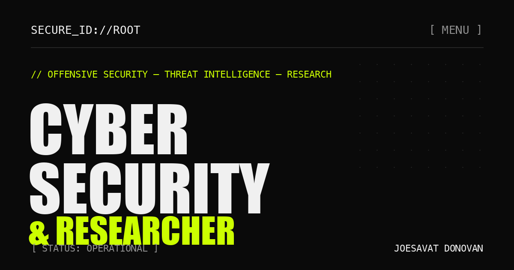

# Joesavat Donovan (`@cingmen`)

> Cybersecurity Practitioner & Offensive Security Researcher  
> Offensive Security // Threat Hunting // Malware Analysis // Vulnerability Research

[](https://cingmen.github.io/)
[](https://linkedin.com/in/joesavatdonovan)
[](https://x.com/cingmen)
[](https://profile.hackthebox.com/profile/01a11023-b9d5-7329-beb7-510274d56bdd)
[](https://cingmen.github.io/.well-known/security.txt)
[](https://cingmen.github.io/#contact)

<p align="center">
  <a href="https://cingmen.github.io/">
    
  </a>
</p>

---

### // FOCUS & CAPABILITIES

- **Offensive Security & Red Teaming**: Adversary emulation, external perimeter assessments (OWASP WSTG / PTES), Active Directory compromise pathways, and segmented network pivoting.
- **Malware Analysis & Forensics**: Reverse engineering (Ghidra, profiled QEMU sandboxes), telemetry reconstruction, C2 directive decoding, botnet protocol dissection, and zero-FP YARA rules.
- **Defensive Engineering**: MITRE ATT&CK detection engineering, Sigma rules, deterministic watchers, threat feeds (BMKG, CISA, NVD), and OSINT automation.

---

### // FEATURED LABS & RESEARCH

- 🛡️ [**cingmen.github.io**](https://cingmen.github.io/) — Interactive zero-dependency research hub & write-up archive.
- 📡 [**osint-harian**](https://cingmen.github.io/osint-harian/) — Deterministic daily public data watcher (BMKG, OFAC, CISA, NVD, WHO, USGS & news RSS) with published diffs.
- 🎣 [**PhishQuest**](https://cingmen.github.io/phisquest/) — Indonesian anti-phishing training game with 40 email, SMS & WhatsApp scenarios plus CLI mode.
- 🗡️ [**Scamurai**](https://cingmen.github.io/scamurai/) — Indonesian anti-scam simulation dojo with 8 interactive scenarios, scammer-side debriefs, ScamDEX, 40-question exam & certificate (offline-first PWA).
- ⚔️ [**BlackGate Perimeter Breach**](https://cingmen.github.io/projects/blackgate-perimeter-breach.html) — Case study on external perimeter breach & multi-stage pivot in a segmented enterprise network.
- 📂 **More Research & Write-ups:** [Operation Nightshade](https://cingmen.github.io/projects/operation-nightshade-ad-red-team.html) (AD Red Team) · [IoT Botnet Telemetry Study](https://cingmen.github.io/projects/iot-botnet-telemetry-study.html) (Malware Research) · [HTB — Lame Write-up](https://cingmen.github.io/writeups/htb-lame-samba-usermap-script.html) (`CVE-2007-2447`)

---

### // REPOSITORY & LOCAL CHECKS

Source code for **[cingmen.github.io](https://cingmen.github.io/)** — built with pure HTML, CSS, and vanilla JavaScript. **Zero frameworks, zero build step, zero trackers, and zero third-party network requests** (all WOFF2 fonts, SVG figures, and scripts are self-hosted).

```text
cingmen.github.io/
├── index.html                        # Homepage — hero, capabilities, arsenal, work, lab, contact
├── projects/                         # Technical case studies (SEO-slugged HTML)
├── writeups/                         # CTF walkthroughs & security research notes
├── 404.html                          # Custom 404 page
├── assets/                           # Self-hosted WOFF2 fonts, SVG diagrams, thumbnails, OG cards
├── tools/                            # Static site verifier (check_site.py) & asset generators
└── feed.xml, sitemap.xml, robots.txt # RSS 2.0 feed & search engine indexing files
```

```bash
python3 -m http.server 8000     # Serve locally at http://localhost:8000/
python3 tools/check_site.py     # Validate links, anchors, alt text, feed & sitemap (runs in CI)
```

---

### // VERIFIED CONTACT & SECURE CHANNEL

Available for **penetration testing engagements, red/purple team exercises, security research, and engineering roles**.

- 🌐 **Web:** [https://cingmen.github.io](https://cingmen.github.io)
- ✉️ **Email:** [joesavat@gmail.com](mailto:joesavat@gmail.com)
- 🔗 **Profiles:** [LinkedIn (`joesavatdonovan`)](https://linkedin.com/in/joesavatdonovan) · [X (`@cingmen`)](https://x.com/cingmen) · [HackTheBox (`cingmen`)](https://profile.hackthebox.com/profile/01a11023-b9d5-7329-beb7-510274d56bdd) · [RSS Feed](https://cingmen.github.io/feed.xml)
- 🔑 **PGP Fingerprint:** `C0AF 2A9B 2CFA BC60 25D4  DD85 C8FB E0D5 211D A1E9` (Key ID: `0xC8FBE0D5211DA1E9`)
- 📄 **RFC 9116:** [security.txt](https://cingmen.github.io/.well-known/security.txt)
